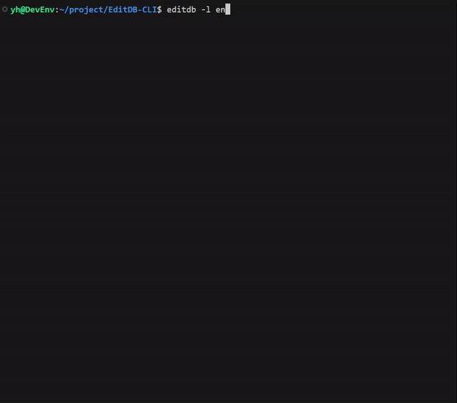

# EditDB-CLI

| [English](README.md) | [Japanese](README_ja.md) |

A CLI tool that allows anyone to easily edit and create SQLite databases.



## Key Features

- **Interactive UI**: Manage databases, tables, and data through an easy-to-use interactive command line interface.
- **Safe Operations**: Builds queries with parameterization to protect against SQL injection.
- **Full Data Management**: Supports creating, reading, updating, and deleting (CRUD) operations for both single and multiple rows.
- **Schema Alterations**: Add/drop columns and rename tables.
- **Multi-language Support**: Available in English and Japanese.

For a full list of features, please see the [Features Documentation](docs/FEATURES.md).

## Installation

Install globally using npm:
```bash
npm install -g editdb-cli
```

## Usage

Simply run the `editdb` command in your terminal.
```bash
editdb
```
The tool will automatically detect SQLite database files in the current directory.

You can also specify a path to a database file:
```bash
editdb ./path/to/your.db
```

### Options
- `--lang [en|ja]`: Specify the display language.
- `-h`, `--help`: Show the help message.
- `-v`, `--version`: Show the version number.

---

For information on setting up your development environment, please read [CONTRIBUTING_ja.md](docs/CONTRIBUTING.md).

## License

This project is licensed under the [MIT License](LICENSE).
