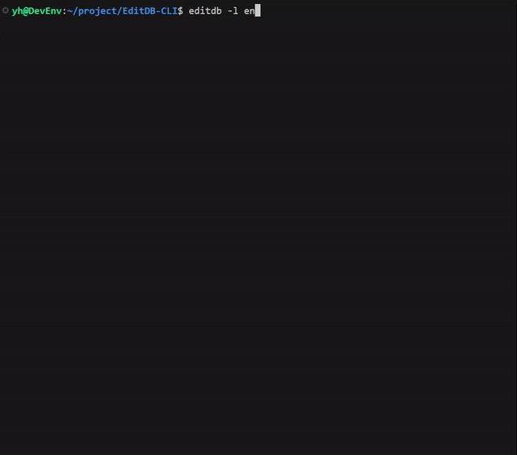

# EditDB-CLI

| [English](README.md) | [Japanese](README_ja.md) |

SQLiteデータベースを誰でも簡単に編集、作成できるCLIツール。



## 主な機能

- **対話型UI**: 使いやすい対話型のコマンドラインインターフェースを通じて、データベース、テーブル、データを管理します。
- **安全な操作**: クエリはパラメータ化によって構築され、SQLインジェクションから保護します。
- **完全なデータ管理**: 単一行および複数行の作成、読み取り、更新、削除（CRUD）操作をサポートします。
- **スキーマ変更**: カラムの追加/削除、テーブルのリネームが可能です。
- **多言語サポート**: 日本語と英語に対応しています。

全機能のリストは[機能一覧ドキュメント](docs/FEATURES_ja.md)をご覧ください。

## インストール

npmを使ってグローバルにインストールします:
```bash
npm install -g editdb-cli
```

## 使い方

ターミナルで`editdb`コマンドを実行するだけです。
```bash
editdb
```
カレントディレクトリにあるSQLiteデータベースファイルが自動で検出されます。

データベースファイルへのパスを直接指定することもできます:
```bash
editdb ./path/to/your.db
```

### オプション
- `--lang [en|ja]`: 表示言語を指定します。
- `-h`, `--help`: ヘルプメッセージを表示します。
- `-v`, `--version`: バージョン番号を表示します。

---

開発環境のセットアップついては、[CONTRIBUTING_ja.md](docs/CONTRIBUTING_ja.md)をお読みください。

## ライセンス

このプロジェクトは[MITライセンス](LICENSE)の下で公開されています。
